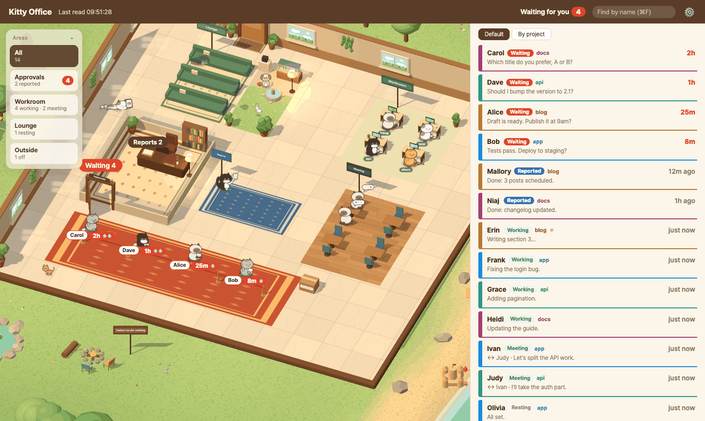
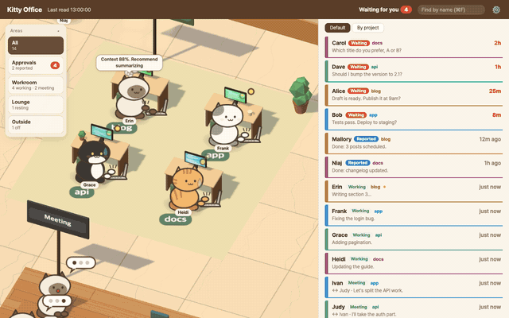
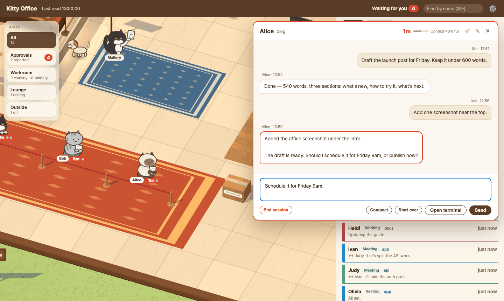
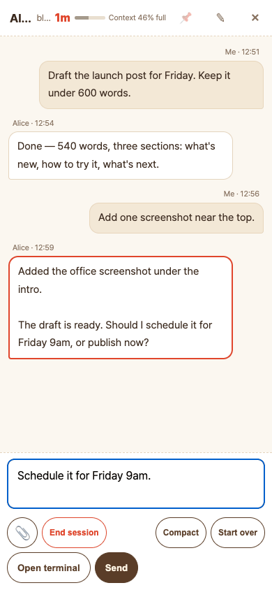

# Kitty Office

[한국어](README.md)

**Your Claude Code sessions as office cats — see who's waiting for you and reply right from the popup.**





## Why

Run five or ten Claude Code sessions at once and you lose track of which one stopped to ask you something. They sit there, politely waiting, while you work in another tab.
Kitty Office turns every session on this Mac into a cat in a small office. Cats that need your answer line up at the approvals desk, busy ones type at their desks, and you reply from a popup without hunting for the right terminal tab.
It answers one question: **"How many things am I blocking right now, and where?"**
Everything runs on this Mac. It reads Claude Code's own session files and never sends your conversations anywhere.

## Features

- **A seat for every state** — waiting for you (approvals line), working (desks), talking to another session (meeting room), reported back (blue rug), resting (lounge cushions, cat tower, boxes, kotatsu), finished for the day (outside by the sea)
- **Reply from the popup** — click a cat or a list row, read the recent conversation and type an answer. It is pasted into that session's real terminal input (cmux, Orca or herdr)
- **Never miss a wait** — a knock sound, a macOS notification, a count in the browser tab title and a red dot on the tab icon
- **End a session** from the popup (`/exit`, then only that terminal tab closes) — blocked while it is working
- **Ten cat personalities** — each coat has its own way of talking in speech bubbles that follow the real situation (waiting for an hour, context almost full, working late)
- **List your way** — urgent first, or grouped by project with a color per folder. Pin sessions to the top
- **On your phone** — open it remotely through a proxy, locked with a token
- **Fire and fishing breaks** — click the campfire outside or the lounge fireplace (fire), the pier by the sea (fishing), or pick one from 🔥 in the header: the camera drifts there and the page goes quiet. Three cats doze around the fire or sit on the pier watching their floats — now and then one lands a fish. Crackle and waves are real recordings (mute with 🔇 — credits in [web/sounds/README.md](web/sounds/README.md)). New approvals still show up in a corner. Esc or a click brings you back
- **Today's to-do board** — a chalkboard on the office wall. Write and tick tasks right on the page, no file to edit; everyone cheers when you finish them all
- **Korean and English** — follows the browser language

## Quick start

```bash
git clone https://github.com/lemontia/kitty-office.git
cd kitty-office
./restart.sh
```

Open **http://127.0.0.1:5430** in a browser. No config and no packages are needed (Python standard library only).

Then start Claude Code as usual — ideally inside cmux, Orca or herdr so you can answer from the page. Within a few seconds each session walks in through the front door as a cat:

- a session working on something sits at a desk and types
- a session that asked you a question joins the approvals line with a waiting time under its feet, and you hear a knock
- the list on the right shows the same sessions, urgent ones first

Sessions started in other terminals (iTerm, Terminal.app) show up too, but read-only.

## Using it



- **Click a cat or a list row** to fly to it and open the popup. Type and press **Enter** to send, **Shift+Enter** for a new line. Paste or drop images and files to attach them. **Esc** closes the popup
- While a session is working you can still send (it reads between steps), or press **Stop** to interrupt it. **Compact** and **Start over** send `/compact` and `/clear`
- **End session** sends `/exit` and closes only that terminal tab. It is disabled while the session is working or an approval prompt is open
- **Open terminal** brings that session's terminal tab to the front (only when the page is opened on this Mac)
- On a computer you can drag the popup by its header and resize it from the corner — it remembers where you left it
- The list: **Default** shows waiting → reported → working → resting → off; **By project** groups by folder (click a group header to fold it). Pin a session with 📌 in the popup and drag ⠿ to reorder pinned ones
- Keyboard: **⌘F** (Ctrl+F) finds a session by name (↑ ↓ to choose, Enter to open), **]** folds the list away on a computer, **Esc** closes the popup
- A cat that has waited over an hour gets bored and plays in line; a report nobody read for an hour ends up lying on the floor watching videos. They are still counted as waiting and reported

- **Today's to-do**: use the panel at the top left (on a phone, tap the 📝 chip or the chalkboard to open it). Type and press Enter to add, tick the box when done, click a task to edit it, × to delete. From the next day, finished tasks fold into 'done earlier' at the bottom and are kept for 30 days (untick to bring one back); unfinished ones stay (red after 3 days, folded into 'overdue' after 7)



## Security & privacy

- The server listens on `127.0.0.1` only. Nothing is reachable from other devices unless you put a proxy in front
- Remote access requires a `token` (16+ characters) — without one the server refuses to start with `allowedHosts` set. Wrong keys are rate-limited
- **A reply is real keyboard input to that terminal.** Anyone who can open the page can type into your sessions — keep the token secret
- No external requests by default. The only one is the optional weather lookup (`weather` in the config)
- `~/.claude` is only read, never written. Attachments you add are saved under `~/Library/Caches/kitty-office/uploads/`

## Requirements

| | What | Without it |
|---|---|---|
| Required | macOS (uses notifications, cache paths, `open -a`, `ps eww`) | does not run |
| Required | Python 3.8+ | does not run |
| Required | Claude Code (reads `~/.claude/sessions`) | no sessions to show |
| Optional | one of cmux, Orca, herdr — only sessions started inside one can be jumped to or answered from the page | read-only (viewing still works) |
| Optional | `terminal-notifier` — clicking a notification jumps to that session | plain macOS notification (no jump) |
| External request | none by default. Only `api.open-meteo.com` (rain or snow outside the window), and only when `weather` is set in the config | |

## Run

```bash
./restart.sh          # http://127.0.0.1:5430 — foreground, restarts when the source changes, Ctrl+C to stop
python3 -m office.server   # run once without watching
OFFICE_PORT=5499 ./restart.sh   # another port
```

No external packages (Python standard library only). It listens on `127.0.0.1` only.
Summary file (read by things like an input-box status line): `~/Library/Caches/kitty-office/wait.json` · attachments: `~/Library/Caches/kitty-office/uploads/` (an existing old `knock-office` cache folder keeps being used)
It only **reads** `~/.claude/sessions/*.json` and `~/.claude/projects/*/<sessionId>.jsonl`.

## How a state is decided (`office/state.py`)

| State | Rule |
|---|---|
| `working` | session is `busy` or `shell` |
| `meeting` | `busy`/`shell` and exchanged messages with another session in the last 10 minutes |
| `waiting` | `idle`, and the last assistant text after the last human input is a question (`is_question`), or an `AskUserQuestion` is left unanswered. Over 24 hours it becomes `stale` (an old question) |
| `reported` | `idle`, not a question, there is assistant text after the last human input, within 24 hours |
| `off` | anything else (a report older than 24 hours, human input is the last line, no transcript) |

- **Question** = the last paragraph contains `?` or a request like "let me know" / "please tell me" (Korean patterns). If it misjudges, fix only `is_question`
- **Not human input**: `tool_result`, cross-session messages (`<cross-session-message>`, `<teammate-message>`), `<task-notification>`, lines that are only `<system-reminder>`, `isMeta`, conversation summaries (`isCompactSummary`), `<local-command-stdout>`. Text typed while the session was working (`queued_command`, origin human) counts as human input
- Session files whose pid is dead, and `entrypoint: sdk-cli` sessions, are skipped
- Only the last 400 KB of a transcript is read
- Constants: `STALE_HOURS = 24`, `MEETING_MINUTES = 10`, `TAIL_BYTES = 400_000`, message log keeps the last 30

Approval/question dialogs are caught too: if the session file's `status` is `waiting` (reason in `waitingFor`), it counts as waiting regardless of the transcript.

## Config (`~/.config/kitty-office/config.json`)

`$KITTY_OFFICE_CONFIG` if set, otherwise `~/.config/kitty-office/config.json` (if that folder doesn't exist but the old `~/.config/knock-office/` does, the old one is used as is). Without a file it runs with defaults (approvals room + lobby, every session in the lobby, shared characters `g1`–`g4`).
Copy `config.example.json` and edit it. `restart.sh` restarts by itself when you save.

| Key | Meaning | Default |
|---|---|---|
| `title` | page header name | `"Kitty Office"` |
| `floors` | floor list `{id, name, order, prefixes}` | lobby only |
| `seats` | folder → character | `{}` |
| `names` | session-name prefix → character. Read backwards, character → display name | `{}` |
| `seatNamesAll` | When `true`, sessions in a `seats` folder are shown as "Alice-1" even if you named them (the real name is kept for messaging) | `false` |
| `workingShells` | A session whose turn ended but still runs a background shell (`shell`) counts as working when a command under it contains one of these strings (e.g. `["render.sh"]`). A session that only keeps a server running still shows as reported | `[]` |
| `notify` | macOS notification when a new wait appears | `true` |
| `allowedHosts` | Host values accepted when opened remotely (e.g. `myhost.example.com:8444`). `127.0.0.1`/`localhost` are always allowed. **Requires `token`** (the server will not start without one) | `[]` |
| `token` | if set, the page is locked, locally too (below). At least 16 characters | `null` |
| `lang` | language of macOS notifications (`ko`, `en`) | macOS language (Korean → `ko`, anything else → `en`) |
| `weather` | set like `{"lat": 37.57, "lon": 126.98}` to ask `api.open-meteo.com` for that spot's weather and draw rain or snow outside the window. Unset means no external request | `null` (off) |
| `cats` | character → cat coat (`mackerel`, `tuxedo`, `ginger`, `siamese`, `calico`, `patch`, `gray`, `black`, `brown`, `cream`). Each coat has its own personality (way of talking). Characters not listed get one by name hash | `{}` |
| `todo.json` (next to `config.json`) | today's to-do items, written by the page — no need to edit by hand | — |
| `colors` · `colors_seen` | folder → list color, and the day it was last seen. Written by the server (folders unseen for 30 days are dropped) | — |

### Floors

- If a session's working folder (cwd) starts with one of `prefixes`, it is on that floor. If several match, **the longest** wins
- Matching is by folder boundary (`~/work/app` does not match `~/work/apps`). `~` expands to home
- Anything unmatched goes to `lobby` (added if missing). The approvals room (`boss`) is fixed in code at the top — do not list it here
- The room look is chosen by `id`: `content` (studio), `hq` (control room), `client` (dev room), `lobby`. Other ids look like the lobby

### Matching characters

1. Session name starts with a prefix in `names` → that character
2. Otherwise the first-started session in a `seats` folder. Skipped if that character was already taken by rule 1
3. The rest → shared `g1`–`g4` (name hash)

A session started without a name in a `seats` folder (auto name "folder-two-hex") is shown with the display name from `names`, like "Alice-1".
Every character is a cat — `kittyTex` in `web/index.html` draws it on a canvas. Pick the coat with `cats`.
The page and its speech bubbles come in Korean and English — Korean browsers get Korean, everyone else English (add `?lang=ko` or `?lang=en` to the address to choose). Lines live in `web/lines.ko.json` and `web/lines.en.json`; names you write in the config (floor names and so on) are not translated.

### Opening it remotely

The server always listens on `127.0.0.1` only. To view it from another device, put a proxy in front (e.g. `tailscale serve --https=8444 http://127.0.0.1:5430`).
Then list that address's Host in `allowedHosts` and set a `token`. **A token is required for remote access** — if `allowedHosts` is set and `token` is missing or shorter than 16 characters, the server prints why and does not start.

- With a `token`, opening `127.0.0.1` on this Mac asks for the key too (so it stays locked behind a proxy that rewrites Host to `127.0.0.1`). Once entered, a cookie keeps you in for a year. Without a `token` the page is local-only and opens without a key
- Open `https://<host>/?token=<token>` once: it sets an HttpOnly, SameSite=Strict cookie and redirects to the address without the token
- After that every request (static files, `/api/state`, POST) checks the cookie or an `X-Token` header. Missing → 401
- Five wrong keys from one address (login form, `?token=` or `X-Token`) block it for 30 minutes
- POST additionally requires an Origin from an allowed Host and `Content-Type: application/json`
- The token goes into URLs and cookies as is, so use letters, digits, `-` and `_` (`python3 -c "import secrets; print(secrets.token_urlsafe(24))"`)

## Tests

```bash
python3 -m unittest discover -s tests -v
```

## License

MIT — see [LICENSE](LICENSE).

Built on macOS. On Windows, sessions started inside herdr can be answered, stopped and ended (no notifications). Linux doesn't work yet — contributions are welcome.
