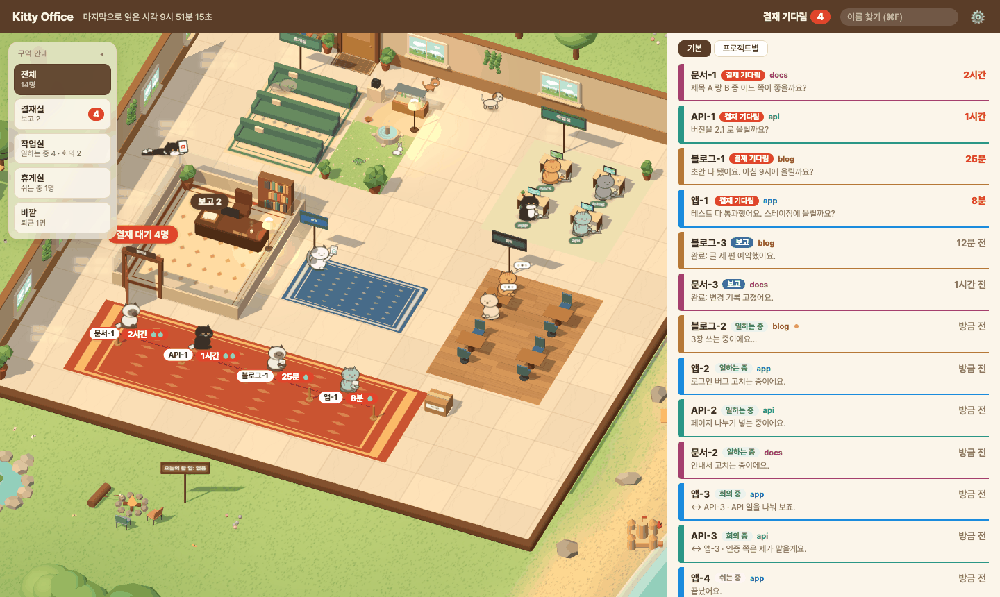
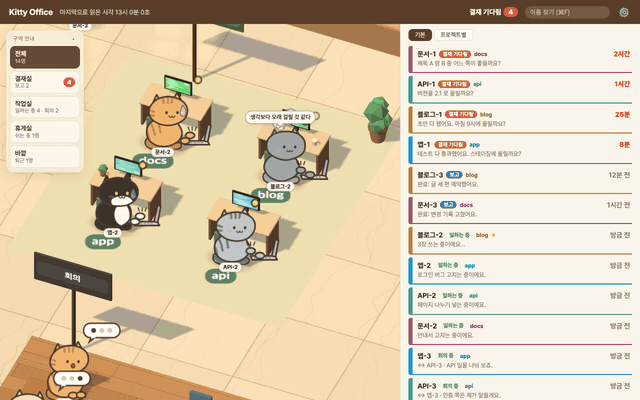
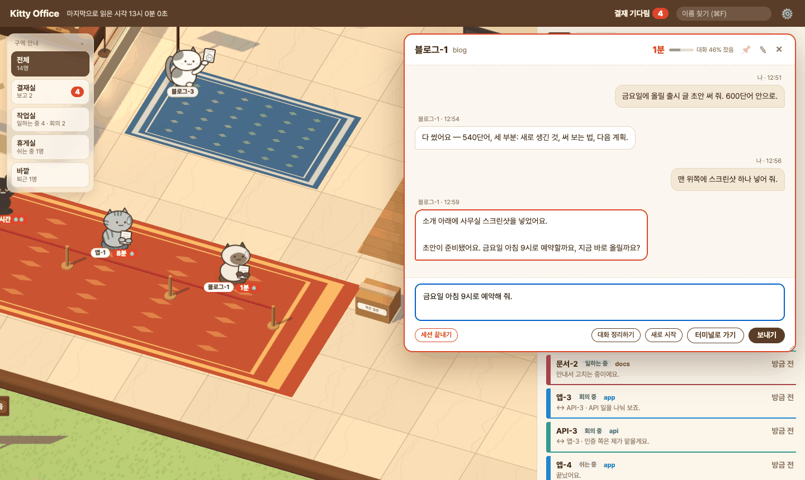
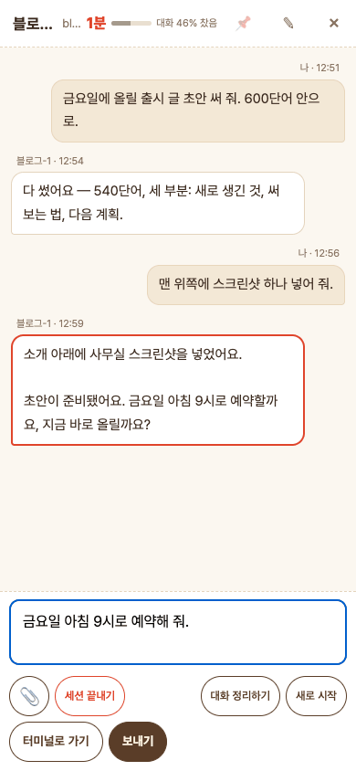

# Kitty Office

[English](README.en.md)

**내 Claude Code 세션들이 사무실 고양이가 된다 — 누가 내 답을 기다리는지 한눈에 보고, 팝업에서 바로 답한다.**





## 왜 만들었나

Claude Code 세션을 대여섯 개, 열 개씩 띄워 두면 어느 세션이 멈춰서 내 답을 기다리는지 놓치기 쉽다. 그 세션은 내가 다른 탭에서 일하는 동안 조용히 기다리기만 한다.
Kitty Office 는 이 맥에 떠 있는 세션을 하나하나 작은 사무실의 고양이로 보여 준다. 내 답이 필요한 고양이는 결재 줄에 서고, 일하는 고양이는 책상에서 타자를 친다. 터미널 탭을 찾아다닐 필요 없이 팝업에서 바로 답한다.
답하려는 질문 하나: **'지금 내가 막고 있는 게 몇 개고, 어디야?'**
모든 것이 이 맥 안에서만 돈다. Claude Code 가 남기는 세션 파일을 읽기만 하고, 대화 내용을 밖으로 보내지 않는다.

## 기능

- **상태마다 자리가 있다** — 내 답을 기다림(결재 줄), 일하는 중(책상), 다른 세션과 이야기 중(회의실), 보고 올림(파란 깔개), 쉬는 중(휴게실 쿠션·캣타워·상자·고타츠), 오늘 끝(바깥 바닷가)
- **팝업에서 답장** — 고양이나 목록 줄을 누르면 최근 대화를 보고 바로 답을 쓴다. 그 세션의 실제 터미널 입력칸에 붙여 넣어진다(cmux·Orca·herdr)
- **기다림을 놓치지 않게** — 노크 소리, 맥 알림, 브라우저 탭 제목의 숫자와 탭 아이콘의 빨간 점
- **세션 끝내기** — 팝업에서 `/exit` 를 보내고 그 터미널 탭 하나만 닫는다. 일하는 중엔 막는다
- **성격이 다른 고양이 10종** — 털 무늬마다 말투가 다르고, 말풍선은 실제 상황(한 시간째 기다림, 대화가 꽉 참, 밤늦게 일함)을 따라간다
- **목록을 내 방식대로** — 급한 것부터 보거나, 폴더마다 색을 칠해 프로젝트별로 묶어 본다. 자주 보는 세션은 맨 위에 고정
- **휴대폰에서도** — 프록시를 앞에 두고 토큰으로 잠가 원격으로 연다
- **불멍·낚시멍** — 바깥 모닥불·휴게실 벽난로(불멍)나 바닷가 부두(낚시멍), 머리줄 🔥 메뉴를 누르면 카메라가 그 앞으로 가고 화면이 조용해진다. 고양이 셋이 불 옆에 둘러앉아 졸거나 부두에 나란히 앉아 찌를 본다 — 가끔 한 마리가 물고기를 낚는다. 장작·파도 소리는 실제 녹음(🔇 로 끈다 — 출처 [web/sounds/README.md](web/sounds/README.md)). 새 결재는 구석에 뜬다. Esc 나 아무 데나 누르면 돌아온다
- **오늘 할 일 칠판** — 사무실 벽의 칠판. 파일을 열 필요 없이 화면에서 적고 체크한다. 다 끝내면 고양이들이 하트를 띄운다
- **한국어·영어** — 브라우저 언어를 따른다

## 빠른 시작

```bash
git clone https://github.com/lemontia/kitty-office.git
cd kitty-office
./restart.sh
```

브라우저로 **http://127.0.0.1:5430** 을 연다. 설정 파일도, 따로 깔 꾸러미도 필요 없다(파이썬 표준 라이브러리만 쓴다).

그다음 평소처럼 Claude Code 를 띄운다 — 페이지에서 답하려면 cmux·Orca·herdr 안에서 띄우는 게 좋다. 몇 초 안에 세션마다 고양이가 정문으로 걸어 들어온다:

- 무언가 하고 있는 세션은 책상에 앉아 타자를 친다
- 나에게 물어본 세션은 결재 줄에 서고, 발밑에 기다린 시간이 붙고, 노크 소리가 난다
- 오른쪽 목록에 같은 세션들이 급한 순서로 나온다

다른 터미널(iTerm·터미널 앱)에서 띄운 세션도 보이지만, 그 세션에는 읽기만 된다.

## 쓰는 법



- **고양이나 목록 줄을 누르면** 그 자리로 다가가 팝업이 열린다. 답을 쓰고 **Enter** 로 보내고, 줄을 바꾸려면 **Shift+Enter**. 이미지·파일은 붙여 넣거나 끌어다 놓으면 첨부된다. **Esc** 로 팝업을 닫는다
- 일하는 중인 세션에도 보낼 수 있다(하던 일 사이에 읽는다). 멈추려면 **하던 일 중단하기**. **대화 정리하기**·**새로 시작**은 `/compact`·`/clear` 를 보낸다
- **세션 끝내기**는 `/exit` 를 보내고 그 터미널 탭만 닫는다. 일하는 중이거나 승인 창이 떠 있으면 누를 수 없다
- **터미널로 가기**는 그 세션의 터미널 탭을 앞으로 가져온다(이 맥에서 연 화면에서만)
- 컴퓨터에서는 팝업 머리를 끌어 옮기고 모서리로 크기를 바꿀 수 있다 — 둔 자리를 기억한다
- 목록: **기본**은 결재 기다림 → 보고 → 일하는 중 → 쉬는 중 → 퇴근 순, **프로젝트별**은 폴더로 묶는다(묶음 머리를 누르면 접힌다). 팝업의 📌 로 맨 위에 고정하고 ⠿ 를 끌어 순서를 바꾼다
- 키보드: **⌘F**(Ctrl+F) 이름으로 찾기(↑ ↓ 로 고르고 Enter), **]** 컴퓨터에서 오른쪽 목록 접기·펼치기, **Esc** 팝업 닫기
- 한 시간 넘게 기다린 고양이는 줄에 선 채 딴짓을 하고, 한 시간 넘게 아무도 안 본 보고는 바닥에 엎드려 유튜브를 본다. 그래도 결재 기다림·보고로 그대로 센다

- **오늘 할 일**: 왼쪽 위 할 일 패널에서 바로 쓴다(휴대폰은 📝 칩이나 칠판을 누르면 창이 열린다). 적고 Enter 로 추가, 다 하면 체크, 글을 누르면 고치고, × 로 지운다. 끝낸 일은 다음 날부터 목록 아래 '끝낸 일'로 접혀 30일 보관되고(체크를 풀면 되살아난다), 못 한 일은 남는다(3일 넘으면 빨갛게, 7일 넘으면 '밀린 일'로 접힌다)



## 보안과 개인정보

- 서버는 `127.0.0.1` 에만 연다. 앞에 프록시를 두지 않으면 다른 기기에서는 열 수 없다
- 원격으로 열려면 `token`(16자 이상)이 꼭 있어야 한다 — `allowedHosts` 를 적고 토큰이 없으면 서버가 뜨지 않는다. 키를 여러 번 틀리면 막는다
- **답장은 그 터미널에 실제로 키보드를 치는 것과 같다.** 화면을 열 수 있는 사람은 내 세션에 입력할 수 있다 — 토큰을 남에게 보이지 않는다
- 기본으로 밖으로 나가는 요청이 없다. 하나뿐인 예외는 설정에 `weather` 를 적었을 때의 날씨 조회다
- `~/.claude` 는 읽기만 하고 쓰지 않는다. 첨부한 파일은 `~/Library/Caches/kitty-office/uploads/` 에 저장된다

## 요구 사항

| | 무엇 | 없으면 |
|---|---|---|
| 필수 | macOS(알림·캐시 경로·`open -a`·`ps eww` 를 쓴다) | 돌지 않는다 |
| 필수 | Python 3.8 이상 | 돌지 않는다 |
| 필수 | Claude Code(`~/.claude/sessions` 를 읽는다) | 보여 줄 세션이 없다 |
| 선택 | cmux · Orca · herdr 중 하나 — 그 안에서 띄운 세션만 화면에서 탭으로 가기·답 보내기가 된다 | 읽기만(보기는 된다) |
| 선택 | `terminal-notifier` — 알림을 누르면 그 세션으로 간다 | 기본 맥 알림(누르면 이동 없음) |
| 외부 요청 | 기본은 없다. 설정에 `weather` 를 적었을 때만 `api.open-meteo.com` 하나(창밖 비·눈) | |

## 띄우기

```bash
./restart.sh          # http://127.0.0.1:5430 — 포그라운드, 소스가 바뀌면 다시 띄움, Ctrl+C 로 끝
python3 -m office.server   # 감시 없이 한 번만
OFFICE_PORT=5499 ./restart.sh   # 다른 포트
```

외부 패키지 없음(파이썬 표준 라이브러리). `127.0.0.1` 에만 연다.
요약 파일(입력창 띠 등 밖에서 읽는다): `~/Library/Caches/kitty-office/wait.json` · 첨부: `~/Library/Caches/kitty-office/uploads/`(옛 `knock-office` 캐시 폴더가 있으면 그곳)
`~/.claude/sessions/*.json` 과 `~/.claude/projects/*/<sessionId>.jsonl` 을 **읽기만** 한다.

## 상태 판정 (`office/state.py`)

| 상태 | 판정 |
|---|---|
| `working` | 세션 `busy`·`shell` |
| `meeting` | `busy`·`shell` 이면서 최근 10분 안에 다른 세션과 메시지를 주고받음 |
| `waiting` | `idle` 이고, 마지막 사람 입력 뒤의 마지막 assistant 글이 질문(`is_question`)이거나 `AskUserQuestion` 이 답 없이 남음. 24시간 넘으면 `stale`(묵은 질문) |
| `reported` | `idle`, 질문 아님, 마지막 사람 입력 뒤 assistant 글이 있고 24시간 안 |
| `off` | 그 밖(24시간 넘은 보고, 사람 입력이 마지막, 기록 없음) |

- **질문** = 마지막 문단에 `?` 가 있거나 '알려 주세요'·'말씀해 주시면'·'해 주시면' 같은 부탁이 있음. 틀리는 경우가 보이면 `is_question` 한 곳만 고친다
- **사람 입력이 아닌 것**: `tool_result`, 세션 간 메시지(`<cross-session-message>`·`<teammate-message>`), `<task-notification>`, `<system-reminder>` 만 있는 줄, `isMeta`, 대화 요약(`isCompactSummary`), `<local-command-stdout>`. 일하는 중에 친 글(`queued_command`, origin human)은 사람 입력으로 센다
- 죽은 pid 의 세션 파일, `entrypoint: sdk-cli` 세션은 뺀다
- 기록 파일은 끝 400KB 만 읽는다
- 상수: `STALE_HOURS = 24`, `MEETING_MINUTES = 10`, `TAIL_BYTES = 400_000`, 메시지 로그 최근 30건

승인·질문 창 대기도 잡는다: 세션 파일의 `status` 가 `waiting` 이면(`waitingFor` 에 사유) 기록과 무관하게 기다림으로 센다.

## 설정 (`~/.config/kitty-office/config.json`)

`$KITTY_OFFICE_CONFIG` 가 있으면 그 파일, 없으면 `~/.config/kitty-office/config.json`(그 폴더가 없고 옛 이름 `~/.config/knock-office/` 가 있으면 옛 것을 그대로 쓴다). 파일이 없으면 기본값(결재실 + 로비, 모든 세션이 로비, 캐릭터는 공용 `g1`~`g4`)으로 돈다.
`config.example.json` 을 복사해 고친다. 고치면 `restart.sh` 가 알아서 다시 띄운다.

| 키 | 뜻 | 기본 |
|---|---|---|
| `title` | 화면 머리 이름 | `"Kitty Office"` |
| `floors` | 층 목록 `{id, name, order, prefixes}` | 로비 하나 |
| `seats` | 폴더 → 캐릭터 | `{}` |
| `names` | 세션 이름 앞부분 → 캐릭터. 거꾸로 캐릭터 → 표시 이름으로도 쓴다 | `{}` |
| `seatNamesAll` | `true` 면 `seats` 폴더 세션은 직접 붙인 이름이 있어도 화면에서 'Alice-1'처럼 바꿔 보여 준다(진짜 이름은 그대로 — 메시지 주소에 쓴다) | `false` |
| `workingShells` | 턴은 끝났는데 뒤에서 셸만 도는(`shell`) 세션 밑에서 이 글자가 든 명령이 돌면 '일하는 중'으로 본다(예: `["render.sh"]`). 서버만 켜 둔 세션은 그대로 보고 | `[]` |
| `notify` | 새 기다림이 생기면 맥 알림 | `true` |
| `allowedHosts` | 원격으로 열 때 받을 Host(예: `myhost.example.com:8444`). `127.0.0.1`·`localhost` 는 늘 허용. **적으면 `token` 필수**(없으면 서버가 뜨지 않는다) | `[]` |
| `token` | 있으면 로컬까지 잠금(아래). 16자 이상 | `null` |
| `lang` | 맥 알림 문구 언어(`ko`·`en`) | macOS 언어(한국어면 `ko`, 아니면 `en`) |
| `weather` | `{"lat": 37.57, "lon": 126.98}` 처럼 적으면 그 좌표 날씨를 `api.open-meteo.com` 에 물어 창밖에 비·눈을 그린다. 없으면 외부 요청 없음 | `null`(끔) |
| `cats` | 캐릭터 → 고양이 털 종류(`mackerel`·`tuxedo`·`ginger`·`siamese`·`calico`·`patch`·`gray`·`black`·`brown`·`cream`). 털마다 성격(말투)이 다르다. 없는 캐릭터는 이름 해시로 | `{}` |
| `todo.json`(`config.json` 옆) | 오늘 할 일. 화면이 적는다 — 손으로 고칠 필요 없음 | — |
| `colors` · `colors_seen` | 폴더 → 목록 색, 마지막으로 본 날. 서버가 적는다(30일 안 보인 폴더는 뺀다) | — |

### 층

- 세션의 작업 폴더(cwd)가 `prefixes` 중 하나로 시작하면 그 층. 여러 개가 맞으면 **가장 긴 것**이 이긴다
- 폴더 경계로 비교한다(`~/work/app` 은 `~/work/apps` 에 안 맞음). `~` 는 홈으로 펼친다
- 어디에도 안 맞으면 `lobby`(빠져 있으면 붙인다). 결재실(`boss`)은 코드에 고정으로 맨 위에 붙는다 — 여기 적지 않는다
- 방 모양은 `id` 로 고른다: `content`(스튜디오)·`hq`(관제실)·`client`(개발실)·`lobby`. 그 밖의 id 는 로비 모양

### 캐릭터 짝짓기

1. 세션 이름이 `names` 의 앞부분으로 시작 → 그 캐릭터
2. 아니면 `seats` 폴더에서 가장 먼저 켜진 세션. 그 캐릭터가 1번으로 이미 잡혔으면 건너뜀
3. 나머지 → 공용 `g1`~`g4`(이름 해시)

`seats` 폴더에서 이름을 안 붙이고 띄운 세션(자동 이름 '폴더명-두자리')은 `names` 의 표시 이름으로 'Alice-1'처럼 바꿔 보여 준다.
캐릭터 그림은 고양이 하나다 — `web/index.html` 의 `kittyTex` 가 캔버스로 그린다. 털 종류는 `cats` 로 정한다.
화면 글자와 말풍선은 한국어·영어 두 가지다 — 브라우저 언어가 한국어면 한국어, 아니면 영어(주소에 `?lang=ko`·`?lang=en` 을 붙이면 그쪽). 대본은 `web/lines.ko.json`·`web/lines.en.json`, 설정에 직접 쓴 이름(층 이름 등)은 번역하지 않는다.

### 원격으로 열기

서버는 늘 `127.0.0.1` 에만 연다. 다른 기기에서 보려면 앞에 프록시를 둔다(예: `tailscale serve --https=8444 http://127.0.0.1:5430`).
그때 `allowedHosts` 에 그 주소의 Host 를 적고 `token` 을 건다. **원격으로 열 땐 `token` 이 필수다** — `allowedHosts` 만 있고 `token` 이 없거나 16자보다 짧으면 서버가 이유를 찍고 뜨지 않는다.

- `token` 을 걸면 이 맥에서 `127.0.0.1` 로 열어도 키를 묻는다(Host 를 `127.0.0.1` 로 바꿔 넘기는 프록시 뒤에서도 잠기게). 한 번 넣으면 쿠키로 1년 간다. `token` 이 없으면 로컬 전용으로 키 없이 열린다
- 처음 한 번 `https://<host>/?token=<token>` 으로 열면 HttpOnly·SameSite=Strict 쿠키를 심고 토큰 없는 주소로 넘긴다
- 그 뒤 모든 요청(정적 파일·`/api/state`·POST)이 쿠키 또는 `X-Token` 헤더를 확인한다. 없으면 401
- 키 입력·`?token=`·`X-Token` 어느 쪽이든 같은 주소에서 다섯 번 틀리면 30분 막는다
- POST 는 추가로 Origin 이 허용 Host 여야 하고 `Content-Type: application/json` 이어야 한다
- 토큰은 URL·쿠키에 그대로 들어가니 영숫자·`-`·`_` 로 만든다(`python3 -c "import secrets; print(secrets.token_urlsafe(24))"`)

## 테스트

```bash
python3 -m unittest discover -s tests -v
```

## 라이선스

MIT — [LICENSE](LICENSE) 를 본다.

macOS 에서 만들었다. Windows 는 herdr 안에서 띄운 세션이면 답하기·중단·끝내기까지 된다(알림은 없음). Linux 는 아직 안 된다 — 기여 환영.
